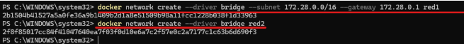
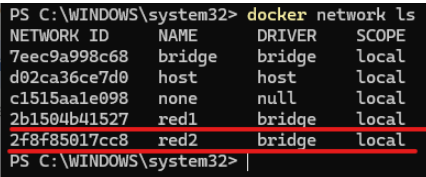
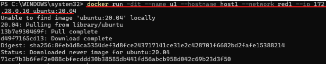
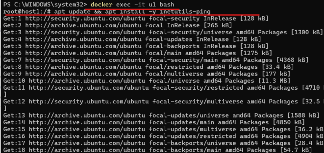
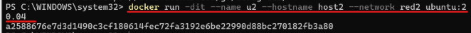
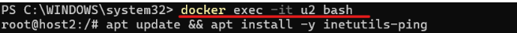
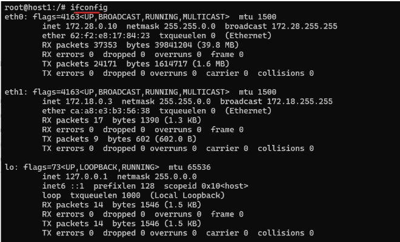
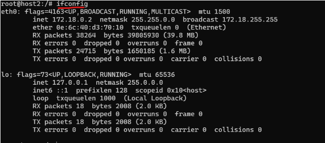
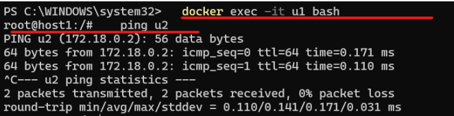
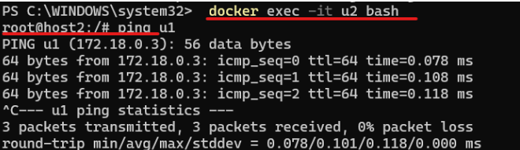

# Redes en Docker

## 5.1. Redes en Docker

## 5.2. Tarea: Creación de redes en Docker (OBLIGATORIA)

En este curso nos hemos centrado únicamente en las redes de Docker de tipo **BRIDGE**, porque son las que más nos interesan como desarrolladores para montar entornos locales lo más similares posible a producción, sin tener que instalar nada o casi nada.

- En el siguiente apartado se detalla la hoja de ruta para resolver la actividad.
- Al final de esta tarea se encuentran los recursos necesarios para su realización.

En esta actividad vamos a crear dos redes de ese tipo (**BRIDGE**) con los siguientes datos:

### Red 1

- **Nombre:** `red1`
- **Dirección de red:** `172.28.0.0`
- **Máscara de red:** `255.255.0.0`
- **Gateway:** `172.28.0.1`

### Red 2

- **Nombre:** `red2`
- El resto de los datos serán proporcionados automáticamente por Docker.

Una vez creadas estas dos redes deberás entregar en un archivo comprimido los siguientes pantallazos:



1. Resultado de la orden `docker network ls`, donde se puedan ver las dos redes creadas correctamente. (`pantallazo1.jpg/png`).



2. Resultado de la orden `docker network inspect red1`, donde se pueda ver la configuración de la red 1 correcta. (`pantallazo2.jpg/png`).

**Nota:** Es muy largo para una captura.

```powershell
PS C:\WINDOWS\system32> docker network inspect red1
```

Configuración relevante de `red1`:

```json
{
  "Name": "red1",
  "Driver": "bridge",
  "EnableIPv4": true,
  "EnableIPv6": false,
  "IPAM": {
    "Driver": "default",
    "Config": [
      {
        "Subnet": "172.28.0.0/16",
        "Gateway": "172.28.0.1"
      }
    ]
  },
  "Internal": false,
  "Attachable": false,
  "Ingress": false,
  "ConfigOnly": false,
  "Options": {
    "com.docker.network.enable_ipv4": "true",
    "com.docker.network.enable_ipv6": "false"
  },
  "Labels": {},
  "Containers": {},
  "Status": {
    "IPAM": {
      "Subnets": {
        "172.28.0.0/16": {
          "IPsInUse": 3,
          "DynamicIPsAvailable": 65533
        }
      }
    }
  }
}
```

3. Resultado de la orden `docker network inspect red2`, donde se pueda ver la configuración que Docker ha dado a la red. (`pantallazo3.jpg/png`).

**Nota:** Sigue siendo muy largo.

```powershell
PS C:\WINDOWS\system32> docker network inspect red2
```

Configuración relevante de `red2`:

```json
{
  "Name": "red2",
  "Driver": "bridge",
  "EnableIPv4": true,
  "EnableIPv6": false,
  "IPAM": {
    "Driver": "default",
    "Config": [
      {
        "Subnet": "172.18.0.0/16",
        "Gateway": "172.18.0.1"
      }
    ]
  },
  "Internal": false,
  "Attachable": false,
  "Ingress": false,
  "ConfigOnly": false,
  "Options": {
    "com.docker.network.enable_ipv4": "true",
    "com.docker.network.enable_ipv6": "false"
  },
  "Labels": {},
  "Containers": {},
  "Status": {
    "IPAM": {
      "Subnets": {
        "172.18.0.0/16": {
          "IPsInUse": 3,
          "DynamicIPsAvailable": 65533
        }
      }
    }
  }
}
```

### Evaluación de la actividad

La evaluación se realizará en base a los siguientes criterios:

- Entrega los documentos y estos documentos contienen los archivos solicitados y los contenidos son originales.

### Entrega de la tarea

Una vez hayas terminado los pasos que te indicamos, debes entregar un único archivo comprimido. El nombre del archivo será el siguiente:

`Tarea_5.2_Nombre_Y_PrimerApellido.zip`

---

## 5.3. Tarea: Conexión de redes a contenedores (OBLIGATORIA)

Una vez hemos creado las dos redes en el apartado anterior, en esta actividad vamos a conectarlas a contenedores en ejecución.

- En el siguiente apartado se detalla la hoja de ruta para resolver la actividad.
- Al final de esta tarea se encuentran los recursos necesarios para su realización.

Deberemos realizar los siguientes pasos:

### 1. Crear el contenedor u1

Poner en ejecución un contenedor de la imagen `ubuntu:20.04` que tenga como hostname `host1`, como IP `172.28.0.10` y que esté conectado a la `red1`. Lo llamaremos `u1`.



### 2. Instalar ping en u1

Entrar en ese contenedor e instalar la aplicación `ping`:

```bash
apt update && apt install inetutils-ping
```



### 3. Crear el contenedor u2

Poner en ejecución un contenedor de la imagen `ubuntu:20.04` que tenga como hostname `host2` y que esté conectado a la `red2`. En este caso será Docker el que le dé una IP correspondiente a esa red. Lo llamaremos `u2`.



### 4. Instalar ping en u2

Entrar en ese contenedor e instalar la aplicación `ping`:

```bash
apt update && apt install inetutils-ping
```



Una vez preparados estos contenedores debemos capturar las siguientes pantallas:

- Pantallazo donde se vea la configuración de red del contenedor `u1` (`pantallazo1.jpg/png`).



- Pantallazo donde se vea la configuración de red del contenedor `u2` (`pantallazo2.jpg/png`).



- Pantallazo donde, desde cualquiera de los dos contenedores, se pueda ver que no podemos hacer ping al otro ni por IP ni por nombre (`pantallazo3.jpg/png`).

**Nota personal:** He ejecutado el comando `docker network connect` antes de leer este apartado, por lo que me da ping.



### 5. Conectar las dos redes

Una vez hemos constatado que los dos contenedores están en redes diferentes y aisladas, conectar la `red2` al contenedor `u1` mediante la orden `docker network connect`.

Comprobar esta última conexión y capturar un último pantallazo (`pantallazo4.jpg/png`), donde se pueda comprobar que ahora, desde el contenedor `u1`, tenemos acceso al contenedor `u2` mediante ping, tanto por nombre como por IP.



### Evaluación de la actividad

La evaluación se realizará en base a los siguientes criterios:

- Entrega los documentos y estos documentos contienen lo solicitado y los contenidos son originales.

### Entrega de la tarea

Una vez hayas terminado los pasos que te indicamos, debes entregar un único archivo comprimido. El nombre del archivo será el siguiente:

`Tarea_5.3_Nombre_Y_PrimerApellido.zip`

---

## Resumen del módulo

**Redes en Docker**

- 5.1. Redes en Docker.
- 5.2. Tarea. Creación de redes en Docker (OBLIGATORIA).
- 5.3. Tarea. Conexión de redes a contenedores (OBLIGATORIA).
